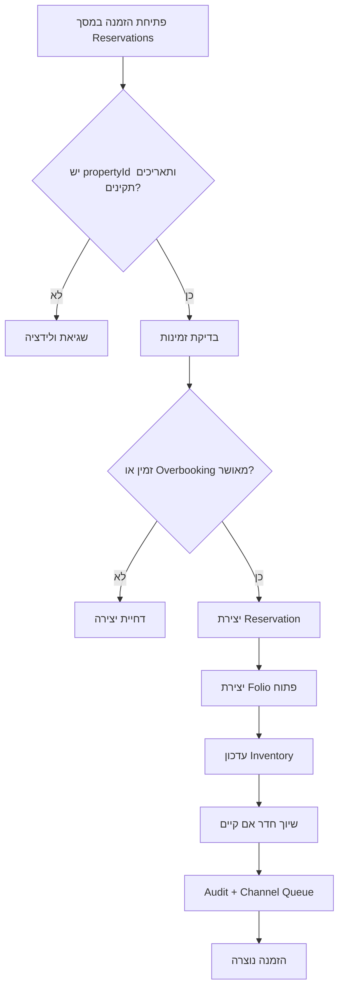
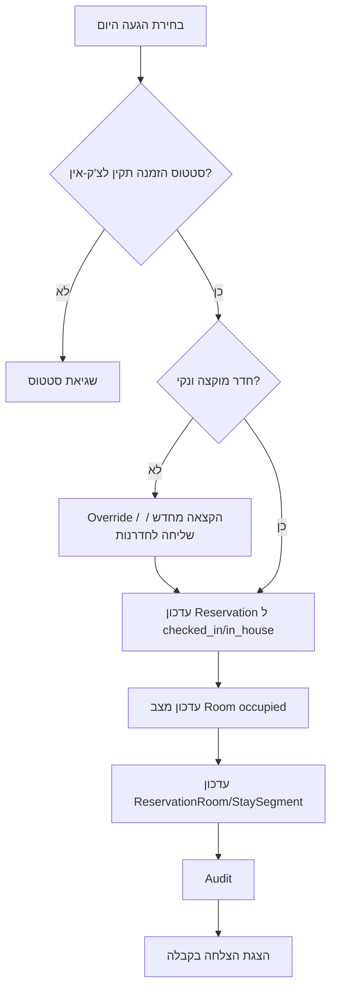
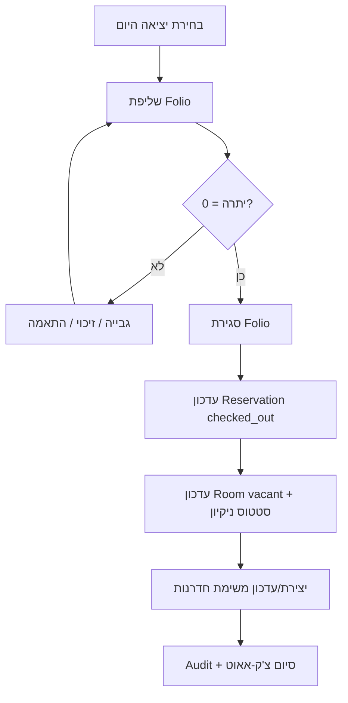
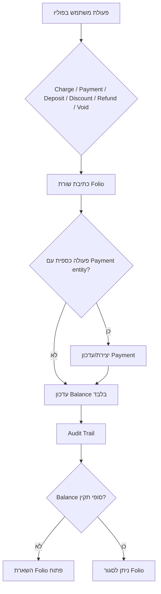
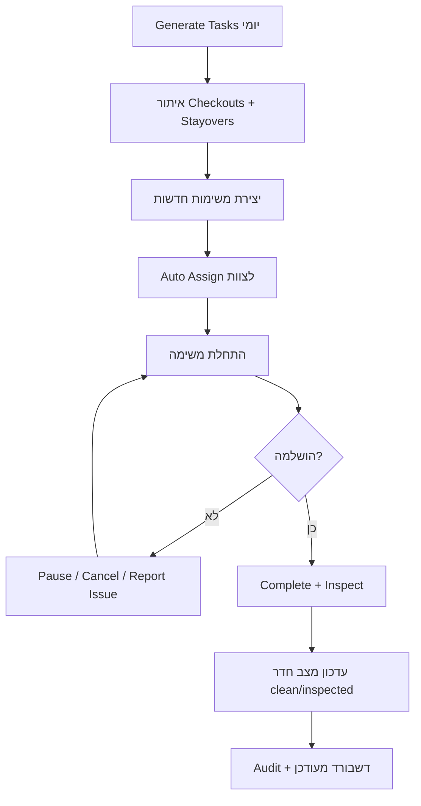
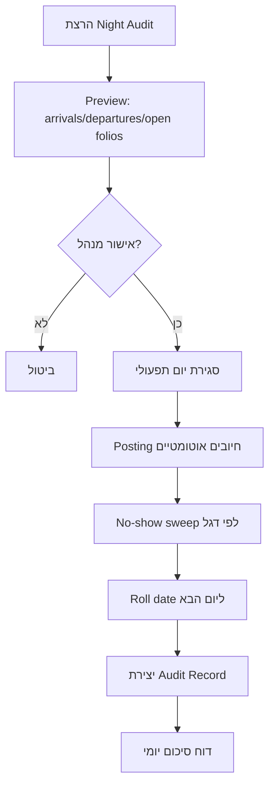

# דוח מיפוי מקצועי - מודול קבלה בלבד (ללא מכירות)

תאריך: 5 במאי 2026  
פרויקט: `hotel4u`

---

## גבול הסקופ

- נכלל: כל `PMS/קבלה` (הזמנות, צ'ק-אין/צ'ק-אאוט, חדרים, אורחים, פוליו, חדרנות, תחזוקה, דוחות, Night Audit, מחירים, חברות, הגדרות).
- הוחרג: מסכי מכירות ו-CRM sales (`/leads`, `/opportunities`).

## ציון מצב נוכחי (קבלה)

- ציון כולל: **4.5/10**
- חזק: עומק פיצ'רים רחב, מודלים עשירים, זרימות עסקיות טובות.
- חלש: גבולות אבטחה והרשאות לא עקביים, דריפט ארכיטקטוני, אמינות/אינטגריטי לא מספקים לפרודקשן מקצועי.

---

## מפת מערכת בפועל (As-Is)

- שרת פעיל של המודול רץ מ-`app.js` ולא `index.js`:
  - `server/package.json`
- PMS מורכב כראוטר נפרד עם `attachActor` בלבד:
  - `server/app.js:190`
- ה-PMS נחשף גם ב-`/api/pms` וגם ב-`/pms`:
  - `server/app.js:216`
  - `server/app.js:217`
- ה-Frontend גם משתמש בנתיבי UI תחת `/pms`:
  - `client/src/App.jsx:169`

### השפעה ישירה

התנגשות API/UI בדיפ-לינק (למשל `/pms/reservations`) - נקודת אי-מקצועיות ארכיטקטונית מרכזית.

---

## מפת יכולות קבלה (פונקציונלית)

- לוח קבלה + התראות + הגעות/עזיבות/שוהים:
  - `client/src/pages/DashboardPage.jsx`
- Room Rack + שיוך חדרים:
  - `client/src/pages/RoomRackPage.jsx`
- הזמנות + lifecycle מלא:
  - `client/src/pages/ReservationsPage.jsx`
- צ'ק-אין / צ'ק-אאוט / פוליו / תשלומים / דוחות / Night Audit / חדרנות / תחזוקה / אורחים / הגדרות.
- ניווט קבלה מוגדר נקי ב-Sidebar:
  - `client/src/components/layout/Sidebar.jsx:66`

---

## מפת נתונים (Data Core)

- ישויות ליבה קבלה:  
  `Reservation`, `ReservationRoom`, `StaySegment`, `Room`, `Folio`, `Payment`, `GuestProfile`, `HousekeepingTask`, `MaintenanceTicket`, `InventoryDate`, `InventoryLock`, `RatePlan`, `Property`, `Company`, `User`.

- דוגמאות סטטוסים מקצועיים קיימים:
  - Reservation: `confirmed/in_house/checked_out/...`  
    `server/models/Reservation.js`
  - Folio: `open/closed/suspended`  
    `server/models/Folio.js`
  - Housekeeping: `new/assigned/in_progress/...`  
    `server/models/HousekeepingTask.js`

---

## ממצאים קריטיים (לפי חומרה)

### 1) קריטי: גבול אימות והרשאות לא Fail-Closed

- `assertPropertyScope` יוצא בלי חסימה אם אין actor:
  - `server/middleware/authContext.js:63`
- במקביל ה-PMS לא מחייב `requireAuth` גלובלי:
  - `server/app.js:190`

### 2) קריטי: יצירת משתמשים ללא gate של מנהל

- `POST /users` ללא `requireRoles`, עם אפשרות `role` מה-body:
  - `server/routes/users.js:37`

### 3) קריטי: Guests/Housekeeping/Dashboard ללא הרשאות עקביות

- Guests endpoints ללא scope/roles:
  - `server/routes/guests.js:29`
- Housekeeping endpoints ללא scope/roles:
  - `server/routes/housekeeping.js`
- Dashboard endpoints ללא scope/roles:
  - `server/routes/dashboard.js`

### 4) קריטי: כפילויות ראוטים ב-Folio + עקביות עסקית נשברת

- כפילויות לנתיבים זהים:
  - `server/routes/folio.js:15`
  - `server/routes/folio.js:235`

### 5) גבוה: באג Runtime בתשלומים

- שימוש ב-`crypto.randomBytes` ללא import:
  - `server/routes/payments.js:291`

### 6) גבוה: תאריך קשיח בדוחות

- ברירת מחדל `to='2026-05-05'`:
  - `server/routes/reports.js:38`

### 7) גבוה: אמינות אינטגריטי נמוכה בפעולות מרובות כתיבה

- ייצור confirmation ידני לפי "אחרון + counter בזיכרון":
  - `server/services/reservationService.js:18`
- לא נמצאו שימושי `withTransaction/startSession` בשרת.

### 8) גבוה: N+1 בדשבורד

- שאילתת Folio בתוך לולאת departures:
  - `server/routes/dashboard.js:213`

### 9) גבוה: דריפט Auth בצד לקוח

- App/Login/Sidebar על `useAuthStore`, אבל TopBar על `useAuth` Context:
  - `client/src/App.jsx`
  - `client/src/components/layout/TopBar.jsx:17`
  - `client/src/context/AuthContext.jsx`

### 10) גבוה: חוסר בדיקות ו-CI

- אין scripts של test ואין workflow CI מובנה:
  - `server/package.json`
  - `client/package.json`

---

## מדדי כיסוי אבטחה (Reception API)

- 18 קבצי routes רלוונטיים, כ-213 endpoints.
- `requireRoles` נמצא ~82 פעמים (כ-38.5%).
- `assertPropertyScope` נמצא ~151 פעמים (כ-70.9%), אבל כיום יכול לא לפעול ללא actor.

מסקנה: הכיסוי הנומינלי נראה טוב, הכיסוי האפקטיבי חלש.

---

## מה יהפוך את המודול למקצועי באמת (Target State)

### 1) Security-by-Default

- `requireAuth` גלובלי לכל `/api/pms/*`.
- `assertPropertyScope` חייב לזרוק 401/403 כשאין actor.
- איסור `propertyId` מהלקוח כ-source of truth; גזירה מתוך token/session.

### 2) RBAC מלא לפי מטריצת תפקידים

- כל endpoint מקבל policy מפורש (read/write/approve/void/reopen).
- בדגש: `users`, `guests`, `housekeeping`, `payments`, `folio`, `reports`.

### 3) API מקצועי ומתועד

- חוזה OpenAPI אחד למודול קבלה (גרסה עדכנית OAS 3.2.0).
- פורמט שגיאות אחיד לפי RFC 9457.

### 4) Data Integrity אמיתי

- טרנזקציות לכל זרימה מרובת מסמכים (הזמנה, צ'ק-אין, צ'ק-אאוט, פוליו/תשלום, Night Audit).
- Confirmation number אטומי באמצעות counter ייעודי (בסיס קיים):
  - `server/models/Counter.js`

### 5) ארכיטקטורה נקייה

- API רק תחת `/api/pms`; UI תחת `/pms` בלבד.
- איחוד שכבת auth ב-frontend (Store יחיד או Context יחיד, לא גם וגם).
- פירוק קבצי route גדולים (בעיקר `folio.js`, `reports.js`) לשירותים ממודרים.

### 6) Quality Gates

- Unit + integration tests למסלולי קבלה קריטיים.
- CI עם checks חובה: lint, tests, security scan, migration check.

---

## KPI מקצועיים (מודול קבלה)

### Security

- 100% PMS endpoints עם auth + RBAC + property scope enforced.
- 0 endpoints שמסתמכים על `propertyId` מהלקוח להרשאה.

### Reliability

- 0 race conditions ב-confirmation numbers.
- 0 inconsistencies בין Reservation/Folio/Inventory אחרי פעולות קריטיות.

### Performance

- P95 ל-Dashboard קטן מ-400ms.
- הפחתת שאילתות N+1 ב-Alerts ל-query batch יחיד.

### Quality

- כיסוי בדיקות לזרימות קריטיות גדול מ-80%.
- 100% merge ל-main רק אחרי CI ירוק.

### Accessibility / UX

- תאימות WCAG 2.2 AA למסכי קבלה מרכזיים.

---

## תוכנית ביצוע 30/60/90

### 0-30 יום (בלימת סיכון מיידית)

- להחיל `requireAuth` גלובלי על PMS.
- להפוך `assertPropertyScope` ל-fail-closed.
- לסגור `POST /users` למנהלים בלבד.
- להסיר mount של `/pms` ל-API (להשאיר `/api/pms` בלבד).
- לתקן באגים מהירים: `crypto` import, תאריך קשיח בדוחות, route כפולים ב-Folio.

### 31-60 יום (הקשחת ליבה)

- מטריצת RBAC מלאה לכל endpoint.
- טרנזקציות בזרימות reservation/check-in/check-out/folio.
- איחוד Auth frontend והסרת דואליות.
- OpenAPI + RFC9457 + ולידציות קלט מחמירות.

### 61-90 יום (רמת Enterprise)

- CI מלא + בדיקות עומק + בדיקות עומס.
- תצפיתיות (traces/metrics/log correlation).
- SLO dashboards תפעוליים (קבלה, חדרנות, תחזוקה, קופה/Night Audit).
- תיקוף WCAG 2.2 AA והקשחת PCI boundary בתשלומים.

---

## תרשימי זרימה (קבלה בלבד)

### 1) יצירת הזמנה



### 2) צ'ק-אין



### 3) צ'ק-אאוט



### 4) פוליו ותשלומים



### 5) חדרנות



### 6) Night Audit



### 7) מפת ניווט קבלה (ללא מכירות)

```mermaid
flowchart LR
    A[/pms/] --> B[/pms/reservations]
    A --> C[/pms/check-in]
    A --> D[/pms/check-out]
    A --> E[/pms/room-rack]
    A --> F[/pms/guests]
    A --> G[/pms/folio]
    A --> H[/pms/housekeeping]
    A --> I[/pms/maintenance]
    A --> J[/pms/rooms]
    A --> K[/pms/rates]
    A --> L[/pms/reports]
    A --> M[/pms/night-audit]
    A --> N[/pms/companies]
    A --> O[/pms/settings]
```

---

## סטנדרטים חיצוניים ששימשו להשוואה

- OWASP API Security Top 10 (2023):  
  https://owasp.org/API-Security/editions/2023/en/0x11-t10/
- OWASP ASVS (גרסה יציבה 5.0.0):  
  https://owasp.org/www-project-application-security-verification-standard/
- OpenAPI Specification (v3.2.0, 19 Sep 2025):  
  https://spec.openapis.org/oas/v3.2.0.html
- RFC 9457 Problem Details:  
  https://www.rfc-editor.org/rfc/rfc9457
- WCAG 2.2 Recommendation (12 Dec 2024):  
  https://www.w3.org/TR/WCAG22/
- NIST CSF 2.0 (Published Feb 26, 2024):  
  https://www.nist.gov/publications/nist-cybersecurity-framework-csf-20
- PCI SSC Document Library (כולל PCI DSS v4.0.1):  
  https://www.pcisecuritystandards.org/document_library/
- STR KPI formulas (Occupancy/ADR/RevPAR):  
  https://str.com/resources/faq

---

## הערת הפעלה

המסמך מכסה את מודול הקבלה בלבד, ומיועד לשמש כבסיס ישיר ל-Backlog ספרינטים, תוכנית remediation אבטחתית, ותוכנית hardening לפרודקשן.
